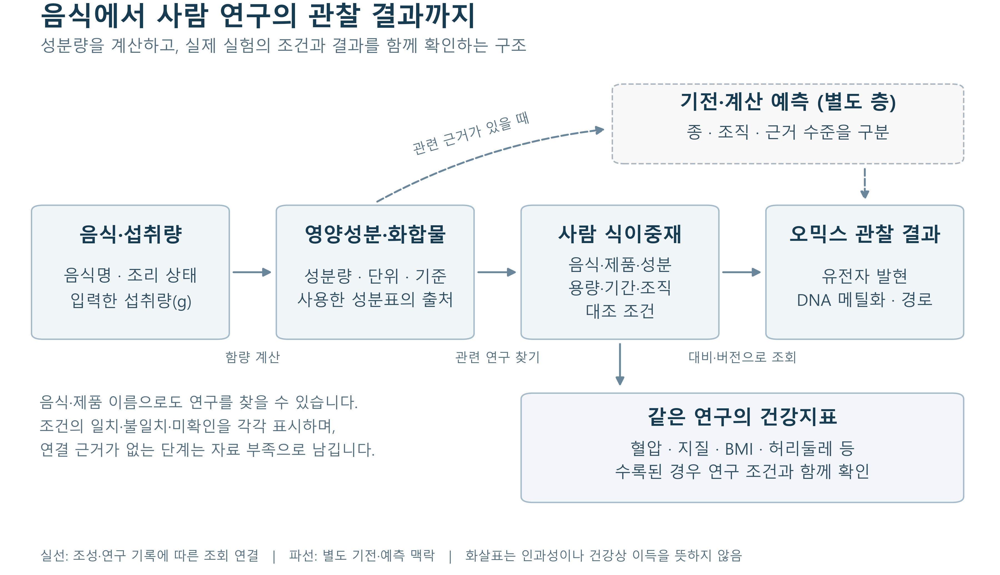

# Database structure

[Overview](../README.en.md) · [한국어](DB_STRUCTURE.ko.md) · [Figure files](figures/db-structure/README.md)

## Reading the diagram

The main sequence is **food and intake amount → nutrients and compounds → human intervention
context → observed molecular results**. The upper dashed box contains separate mechanistic and
computational relationships. The lower box contains reported clinical measurements from the
same study. Arrows represent data joins; they do not establish dietary causality or full coverage.

A selected food record supplies the composition basis. A related intervention retains the tested
food or product, dose, duration, tissue and comparison. Expression, DNA methylation and pathway
results are retrieved for that comparison. Same-study clinical summaries are separate records,
not evidence that a molecular change mediated a clinical outcome.

## Records and joins

| Records | Contents | Join |
|---|---|---|
| Food | Names, aliases, preparation state and source code | Food ID |
| Composition | Component, amount, unit, basis, missing state and source | Food and component IDs |
| Intervention | Study, exposure, arm, dose, duration, tissue and contrast | Study, exposure, arm and contrast IDs |
| Molecular result | Feature, effect estimate and statistics | Five-part analysis key |
| Clinical and external context | Same-study measurements, separate regulatory annotations and predictions | Study ID or a typed, source-backed edge |
| Provenance and review | Source URL, version, hash, access conditions, review decision and analysis settings | Record/file IDs and hashes |

The analysis key is `series + feature_type + feature_id + contrast + analysis_version`.
Different comparisons or versions remain separate. A nearby-gene annotation, eQTM association,
tested regulatory link and computational prediction remain different relationship types.
Fixed 1 kb region tests are not counted as discovered or validated DMRs.

## Storage

SQLite stores entities, measurements and typed relationships in `node`, `measurement` and `edge`.
`science_record` stores studies, exposures, arms, contrasts, analyses, assertions and clinical
summaries. Large results are also available through CSV/Parquet and their analysis keys.
Query indexes refer to original results. Original data, derived data, analysis outputs and
serving releases are separate. A manifest and file hashes identify each prepared version.

## Yogurt example

For 150 g of yogurt, calculate components only from a selected food with a confirmed composition
basis. If a related study tested 800 g, retain that dose, product identity status and measurement
times. Retrieve its original contrast results without multiplying effects by 150/800.

Unknown conditions and missing links remain explicit. Automatically extracted literature is
candidate material pending inclusion and access decisions. For counts, availability and unfinished
review, see [status](PROJECT_STATUS.md) and the [count record](reference-data-summary.json).
